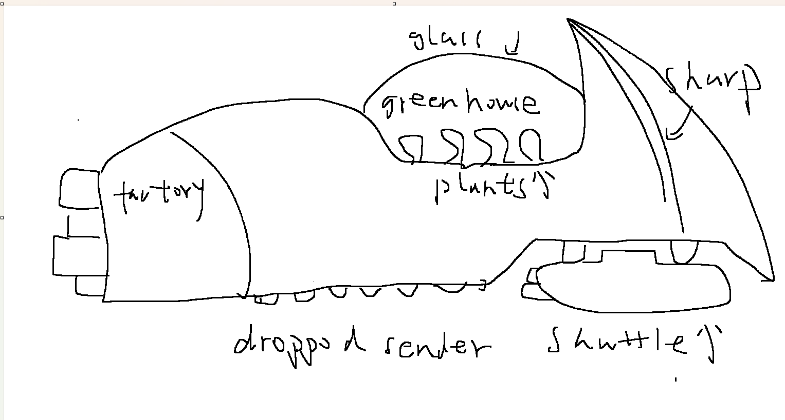
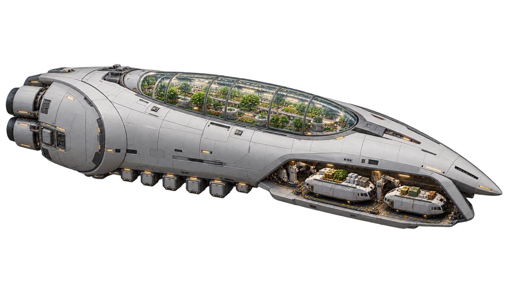

# Frontier: process overview

Building Frontier meant repeatedly translating the game I imagined into
instructions agents could act on, then judging their interpretations in play.
I set the direction, supplied hand-drawn references, selected generated audio,
and decided what needed changing. I wrote some instructional material myself;
agents wrote nearly all the code and drafted most documents from our exchanges,
including this one.

## From brief to direction

The [brief](https://comp.anu.edu.au/courses/comp4020-agentic-coding-studio/assessments/final-project/)
asks for shared state, updates within about a second and durable consequences.
I asked what gets more interesting as people join while still working for one
person, and chose a cooperative planetary war, influenced by Helldivers 2.
[GAME_IDEAS.md](GAME_IDEAS.md) is my brainstorm, not a specification. I asked for
something playable before more discussion:
[`3bda7a0`](https://github.com/comp4020-agentic-coding-studio/comp4020-final-jnheinrich451-eng/commit/3bda7a0),
on the supplied
[`60ec68b`](https://github.com/comp4020-agentic-coding-studio/comp4020-final-jnheinrich451-eng/commit/60ec68b).
Earlier stages were never committed separately.
Codex consolidated my [brainstorm](GAME_IDEAS.md) into [GAME_DESIGN.md](GAME_DESIGN.md)
([`45511ea`](https://github.com/comp4020-agentic-coding-studio/comp4020-final-jnheinrich451-eng/commit/45511ea)),
keeping agreed behaviour apart from proposals.

My [definition of good](README.md#what-good-means-here) for War Zone became: defeat
leaves a way back while losses still matter. Juul informed that choice; his
limited evidence cannot establish that Frontier is enjoyable.
Sloan's home-cooked software informed the small scale, although public accounts
make this different from his family app. Colonization offers peaceful lasting
progress, with separate saves and construction that survives neglect.

## Stack and trade-offs

Within Fly's one shared CPU and 256 MB, I chose Node's HTTP server, built-in
SQLite and Canvas 2D: a small stack I could inspect and measure without an engine
or framework. I did not benchmark engines; this was a practical choice.

Commands travel over HTTP and snapshots over server-sent events, on a 100 ms tick.
Requests add overhead and synchronous writes can stall a tick. Cosmetic rendering
runs in browsers; the server still owns combat outcomes. Each campaign has its own
SQLite world. [ADR-001](docs/decisions/001-owner-present-campaigns.md) keeps rooms
open only with their owner present, preventing friends from playing while the
owner is away; [ADR-002](docs/decisions/002-identity-and-permissions.md) separates
account owners from guests. Unregistered guests lose personal progress when their
visit ends; contributions remain in the host's world.

## How I worked

My instructions ranged from open questions to detailed rules and labelled
drawings. The [design worksheet](GAME_DESIGN_WORKSHEET.md) preserves that mixture:
I described encounters and facilities, but also left decisions for the agent to
propose. Documents carried those decisions between sessions: GAME_DESIGN held the
direction, [CLAUDE.md](CLAUDE.md) the lasting rules, and [stage records](docs/)
the changes and evidence. Their wording also needed review: an agent's summary
could lose a distinction I cared about.

I reviewed a bounded proposal, let the agent implement and check it, then played
and corrected the result. Codex and Claude Code worked in parallel on different
parts of the game. Sharing a working tree required commits naming exact paths
([`489da0b`](https://github.com/comp4020-agentic-coding-studio/comp4020-final-jnheinrich451-eng/commit/489da0b)).
The cases below examine selected corrections. The [evidence guide](docs/evidence/README.md)
opens the wider collection of drawings, prompt/image pairs, audio and checks.

## Drawings made the visual instructions more precise

The carrier's first render kept my greenhouse but flattened the sharp bow. My
[second sketch](docs/evidence/mycorrhizal-carrier/sketch-2-scythe.png) and
[Codex's revised prompt](output/video-frames/mycorrhizal-carrier-concept-v2-prompt.txt)
made the scythe profile explicit in the [next render](docs/evidence/mycorrhizal-carrier/mycorrhizal-carrier-concept-v2.png).
The [sequence](docs/evidence/mycorrhizal-carrier/README.md) preserves that correction
and further attempts to open the shuttle bay.

| My first sketch | First generated interpretation |
| --- | --- |
|  |  |

[Read Codex's prompt for this render](output/video-frames/terraforming-carrier-concept-v1-prompt.txt).

The [Iowa-style gunship](docs/SHIP_VISUAL_SCALE.md#iowa-silhouette-24-october-2026)
likewise needed separate hull, turret and mount corrections. Isolating each part
made review specific.

The [rail MAC](docs/RAIL_WEAPONS_POLISH.md#electromagnetic-mac-appearance-25-october-2026)
exposed a motion ambiguity: a ring turning around the barrel became a gear spinning
in place. My labelled sketch clarified the geometry; seeing it move exposed what
the drawing alone had not settled.

I stopped the intro video at one scene, now the [title loop](docs/OPENING_LOOP.md),
because further work did not repay the time.

## Audio needed listening as well as integration

I communicated musical direction through reference styles and used Gemini for
the tracks. I chose the War Zone assignments and left the colony pairings to
Codex ([music record](docs/AUDIO_PLAN.md)). The exact music prompts are not
recorded here. For effects, Codex inventoried weapons and proposed missing calibres;
I generated and selected ElevenLabs recordings. Most needed two or three prompt
revisions; the retained [generation history](soundeffect/GENERATION.md#origin-and-authorship)
shows three for the [machine gun](docs/evidence/sound-generation/elevenlabs-machine-gun-prompts.png)
and four for the [railgun](docs/evidence/sound-generation/elevenlabs-railgun-prompts.png).
Even then, a burst was
wrong for individual machine-gun shots, so I supplied a single-shot replacement.

Integration exposed a different problem: checks passed while I heard silence.
They counted sources starting but missed the disconnected speaker output. The
[fix](docs/WAR_ZONE_GENERATED_AUDIO.md#silent-output-correction)
added an output check, now required by CLAUDE.md. I confirmed playback on
9 November, then uneven levels prompted [measured loudness gains](docs/SOUND_LOUDNESS.md).
Audibility, matching the action and fitting the mix each needed separate review.

## Playing changed the interface and the rules

The [HUD revision](docs/HUD_AND_POLISH_STAGE.md#remote-command-strip) began with
a picture mock-up and my request to read it in one second. After using its
remote vehicle panels, I made that goal concrete: left click attacks, right click moves,
and other commands use one word and one key. The graphite-and-gold redesign
landed in
[`5bbd038`](https://github.com/comp4020-agentic-coding-studio/comp4020-final-jnheinrich451-eng/commit/5bbd038).

Colonization exposed a deeper mismatch. Codex built the production chain from my
machine list
([`631b10d`](https://github.com/comp4020-agentic-coding-studio/comp4020-final-jnheinrich451-eng/commit/631b10d)),
but its panels felt "like an engineer file" and its power startup "a dead loop".
Manual loading was intended to start the chain, but that was unclear in play.
My [correction](docs/COLONY_INDUSTRY_STAGE.md#8-november-2026-one-card-one-job-a-charged-start)
led from the [earlier inspector](docs/testing/evidence/2026-11-02/colony-industry-processor-phone.png)
to [simpler cards](docs/testing/evidence/2026-11-08/colony-card-phone.png), automatic
recipe selection and a one-time starter power reserve: changes to interaction and
starting conditions as well as wording.

## What became reusable

Corrections entered the harness. When I revised
[Bulwark hazards](docs/FUEL_STREAM_STAGE.md#fuel-pools-and-gas-and-fire-against-breakers-and-bulwarks-built),
gas gained damage at 20 hp/s and fire halved movement speed without HP damage;
explosives and magnetic weapons remain effective. CLAUDE.md and
[tests](spec/bulwark.test.ts) preserve that distinction. A flaky docking check
likewise became a rule to wait for observed state instead of a fixed sleep
([`140331b`](https://github.com/comp4020-agentic-coding-studio/comp4020-final-jnheinrich451-eng/commit/140331b)).

My experience with the course instructions and SKILLS was that an agent could
complete a defined technical stage in one run. Stages of
[SMTP email registration](docs/ACCOUNT_DESIGN.md#architecture-and-local-entry-points),
[multiplayer cooperation](docs/CAMPAIGN_STAGE.md#small-stages-with-observable-results)
and the game's architecture were examples. The design kept changing, but agents
could implement each agreed revision. Art style, music and UI needed more rounds
of looking, listening and playing before I could settle the requirements.
A completed implementation gave me something concrete to judge; it did not end
the design work. The files then carried my corrections into the next stage.

## Limits

Sustained four-player combat on Fly is unmeasured; an idle four-client probe is
not a combat benchmark. Latency measurements are local. CI skips the full browser
suite, whose repair found [four real bugs](docs/HUD_AND_POLISH_STAGE.md#full-browser-suite).
My judgement of feel has no recorded independent playtest. The commit history also
bundles stages; the linked records retain decisions those large commits obscure.
