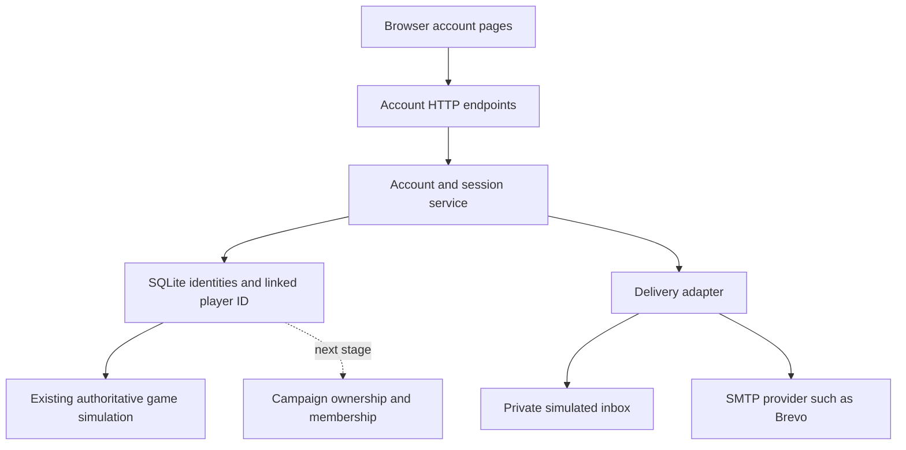

# Frontier account design

Implemented locally, 9 October 2026: registration, login, verification, resend,
logout, password recovery and a private simulated inbox. Real email uses SMTP;
the transport passed local capture tests, but Brevo inbox receipt is not yet
verified. No production deployment or real outgoing email occurred in this stage.

The subsequent [entry and campaign design](ENTRY_AND_CAMPAIGNS.md) confirms
ordinary real addresses (no ANU restriction), owned campaigns or joining a
friend, and planet selection before orbital core landing. Login establishes
identity, not a private world. The implementation defaults below keep guest
progress and require explicit confirmation before taking over another session;
these were stated during implementation and can still be revised by the author.

## Architecture and local entry points

`accounts/service.js` owns identities, sessions, action tokens, private inboxes
and attempt limits. `accounts/passwords.js` bounds password hashing separately
from the simulation. `accounts/mail.js` adapts SMTP. `server.js` routes requests,
resolves the stable player ID and revokes live control. Browser pages live in
`public/account.html`, `account.js` and `account.css`. The game retains its Canvas,
Node HTTP and SQLite architecture; adding accounts does not require a new engine
or framework.

Open `/register/`, `/login/`, `/account/` or the game's ID button. Demo users see
DEMO on the battlefield. Login and Play as guest now return to the planet/campaign
lobby at `/`. Guests join by invitation; Email/Demo accounts can also host.
The preserved shared field test is explicitly available at `/?legacy=1`.

## What the reference actually does

Read-only inspection of `../comp4020-crit7-jnheinrich451-eng` covered
`src/pages/login.astro`, `src/pages/register.astro`,
`src/components/AccountModes.astro`, `src/lib/auth.ts`, `src/lib/mail.ts`,
`src/lib/demo-inbox.ts`, `src/lib/passwords.ts`, and
`docs/demo-inbox-design.md`. Existing account tests were inspected, not run.

- Normal and Demo are explicit tabs on both registration and login.
- Normal accepts ANU addresses and requires a single-use emailed verification
  link. Mail uses Nodemailer with runtime SMTP configuration; the source is
  provider-independent. Brevo is the author's reported provider, not something
  confirmed by inspecting secret configuration or sending mail today.
- Demo accepts a chosen `@enrolment.test` address and password. It delivers
  simulated links into a private browser inbox; it never sends real email.
- Demo inbox access requires account creation, password authentication or an
  existing authenticated session. Knowing an address cannot open its inbox.
- Accounts persist; duplicate registration cannot replace credentials or data.
  Password recovery in Demo requires retained authorized inbox/session access;
  losing both that access and the password is not recoverable through fake mail.

Reuse these boundaries, not the ANU restriction, student/reviewer roles, academic
schema or Astro routes. Frontier uses native Node HTTP and `node:sqlite`.

## Implemented player flow

Immediate **Play as guest** remains available, with an Account entry in the game
interface, `/login/` and `/register/` pages and two explicit modes:

| Mode | Registration | Return and recovery |
| --- | --- | --- |
| Email account | Display name, ordinary real email, password; verify through the emailed link | Email/password login; emailed password reset |
| Demo account | Display name, chosen `name@frontier.test`, password; confirm in a private simulated inbox | Demo address/password login; recovery only through retained authorized access |

Label Demo persistently: its activation is simulated, not proof of email
ownership. Reserve the demo namespace and reject it in real mode. A delivery
failure must never switch a real account into Demo. SMTP acceptance means the
provider accepted the message; completing verification establishes inbox access.
Never put email addresses into public player snapshots or nameplates.

## Player identity and saved progress

**Current:** guests use the browser-bound `frontier` cookie and a `scouts` row.
Accounts use a separate hashed, expiring session mapped to the stable scout ID.
Ownership, robot state, equipment and vehicle occupancy retain that ID.
Host-owned rooms are now implemented separately in `campaigns/service.js`; see
[CAMPAIGN_STAGE.md](CAMPAIGN_STAGE.md). An account's stable identity maps to its
own saved pilot in each campaign, including a promoted guest's existing pilot.

**Implementation default:** when a guest creates an account, link that same scout
ID after successful activation. Preserve
position, robot state, ownership and equipment. Account registration should not
rewrite each world object's owner or regenerate the world.

- Persist a pending association only from the authenticated guest initiating
  registration. Never trust an arbitrary player ID supplied by the browser.
- Claim the guest once in a transaction with uniqueness checks. Duplicate
  registration, replayed links and two simultaneous claims cannot steal a scout.
- Rotate credentials at attachment and invalidate the old guest token. A saved
  guest cookie must not remain an alternative way into the claimed player.
- Login to an existing account resumes its linked player. Do not silently merge
  a different local guest's property into that account. Explain the switch and
  preserve that guest's return access; an explicit merge tool can wait.
- Logout/reset must invalidate affected live streams and control access, clear
  held inputs and release facility control. Preserve saved life and occupied
  vehicle recovery rules; authentication must not duplicate a seated robot.
- One account session at a time. A second login asks for explicit takeover before
  revoking the earlier session. Logout, takeover, activation and password reset
  stop held input, release facility control and close relevant event streams.
  An expired session rejects requests immediately; heartbeat closes its stream
  within 15 seconds. Tabs sharing the same session still share one player.

Account access does not automatically create a private room. Campaign creation,
ownership and the plain campaign list are now implemented as a separate layer.

## Persistence and resource bounds

The existing SQLite database now includes `accounts`, `account_sessions`,
`account_tokens`, `demo_inboxes`, `demo_messages` and `account_limits`. Demo
activation and real email verification use different fields. Email addresses and
account details are private and excluded from game snapshots. Tokens are hashed;
Demo links are reconstructed from an inbox secret and stored nonces. Sessions
and inbox grants last eight hours; action links last 30 minutes and are single-use.
Account changes require same-origin JSON POST; cookies are HttpOnly and Secure on
HTTPS. Mail links use fragments, removed from browser history after page load,
and require explicit confirmation. Account pages/API responses are not cacheable.

Scrypt uses the reference's approximately 32 MiB profile, with only one derivation
at a time and no unbounded waiting queue. At most two SMTP sends run at once;
delivery deadlines, persisted attempt limits, account caps and expired-token
cleanup bound work and storage. Reopening a Demo inbox revokes its prior grant;
only the newest message of each purpose remains. Representative combined combat
and authentication capacity is still unmeasured on Fly.

Brevo configuration belongs in server-only runtime secrets: `SMTP_HOST`,
`SMTP_PORT`, `SMTP_USER`, `SMTP_PASSWORD`, `MAIL_FROM`, plus a trusted
`APP_ORIGIN` for links. Brevo documents `smtp-relay.brevo.com`, an SMTP login and
an **SMTP key**, distinct from an API key. See
[Brevo's SMTP setup](https://help.brevo.com/hc/en-us/articles/7924908994450-Send-transactional-emails-using-Brevo-SMTP).
Do not copy credentials from Crit 7. Missing mail configuration leaves guest
play, Demo and existing account login usable, while explaining that real email
registration/recovery is unavailable.

For local setup, copy [config/mail.env.example](../config/mail.env.example) to
the ignored root `.env`, enter server-side values, set `APP_ORIGIN` to the actual
origin and restart `pnpm dev`. Real SMTP requires an HTTPS origin; HTTP is accepted
only with a localhost SMTP capture server. A local HTTPS tunnel can supply the
origin for real-mail testing. On Fly, use runtime secrets. No credentials are
embedded in the client or image. `pnpm dev` and `pnpm start` load `.env` when it
exists; credentials are not required for Demo testing.

For localhost play while keeping production mail settings in .env, put
APP_ORIGIN=http://localhost:8080 in the ignored .env.local file. The dev command
loads that optional override after .env; production start does not load it.
Use the matching browser URL (including port), and restart dev after changing
these files. Demo login works without real mail delivery. For an HTTPS tunnel
mail test, change or remove the local override to match that tunnel's origin.
Never fix an origin mismatch by removing the account/campaign origin checks.

Deployment update, 11 October: the six variables above were configured as Fly
runtime secrets using the author's supplied local configuration. The existing
production image was restarted; the live account status reports SMTP configured.
Brevo initially rejected authentication with `525 unauthorized IP`. After the
author authorized the Fly machine's outbound IP in Brevo, connection, TLS and
SMTP authentication passed from that machine. No email was sent by this check;
sender acceptance, inbox receipt and the complete real registration flow remain
unverified. The author's subsequent screenshot shows a verified sender with
DKIM and DMARC configured.

Local ignored configuration does not deploy itself. Keep secrets out of Git and
sync future configuration changes separately. Fly's default outbound IP can
change; a later Brevo IP rejection may require updating the allowlist. No paid
static egress address was allocated in this stage.

Update, 12 October: the author reports that their registration email reached
their ANU mailbox in Junk, and that Brevo suspended the account. Receipt is now
user-reported; completing verification and the reason for suspension remain
unconfirmed. The mail copy now identifies Frontier as a COMP8020 student project,
explains the registration or password-reset request, and retains the single-use
30-minute link and unsolicited-request guidance. The revised wording alone
does not establish improved deliverability or reactivate Brevo. No further
real email was sent as part of the copy change.

## Reset compatibility and checks

The local world-reset tool backs up the complete database, clears world progress
and unlinked guests, but preserves accounts and both linked/pending player IDs.
It signs out account sessions and puts retained players at the map reference
position, ready to enter orbit. It refuses unknown future tables. This is an
explicit operator test reset, not a normal login/logout effect.

Checks passed: typecheck and 175 tests, including preserved ownership/identity,
private inbox isolation, replay/expiry, failed email, takeover, password reset,
reset-tool retention and SMTP delivery to a local capture server. Four selected
browser checks cover Demo registration/login/logout and orbital landing, each
on desktop and phone. Password/real-email flows have HTTP tests; actual Brevo
receipt remains an external integration check. No new real email has been sent.

The Node 24 production image builds successfully. An isolated 256 MiB container
also completed Demo registration, verification and login while preserving the
guest player ID. This is a compatibility smoke check, not a multiplayer capacity
measurement.

Still separate work: account-email changes/deletion, guest merging, recovering a
Demo account after both its password and authorized browser access are lost,
account-addressed/email invitations. Isolated campaigns, code invitations and
the planet selector are implemented locally; the legacy public world is not awarded to
the first registrant. Retain distinct statuses for implemented behavior, measured
capacity and verified provider delivery.

## Testing two players on one computer (12 October)

Normal tabs and windows in one browser profile share the Frontier login cookie.
Creating two accounts does not give different tabs independent login sessions.
Use the host account in a normal window and the teammate in a private window,
a separate browser profile, or another browser. Multiple private windows may
also share their private session; one normal plus one private is the simple pair.
Keep the host signed in and connected while the teammate redeems the invitation.
Each new campaign member begins in orbit and deploys their own core and robot.

A local browser regression creates both Demo accounts sequentially in one profile,
then verifies that two normal tabs represent one player. Signing the second
account into an isolated browser context yields distinct player IDs, two cores
with different owners, and independent robot movement visible to the peer.
The scenario passed; Windows runner teardown required interruption after its OK
result. This does not inspect or change the user's Fly accounts or saved campaign.
