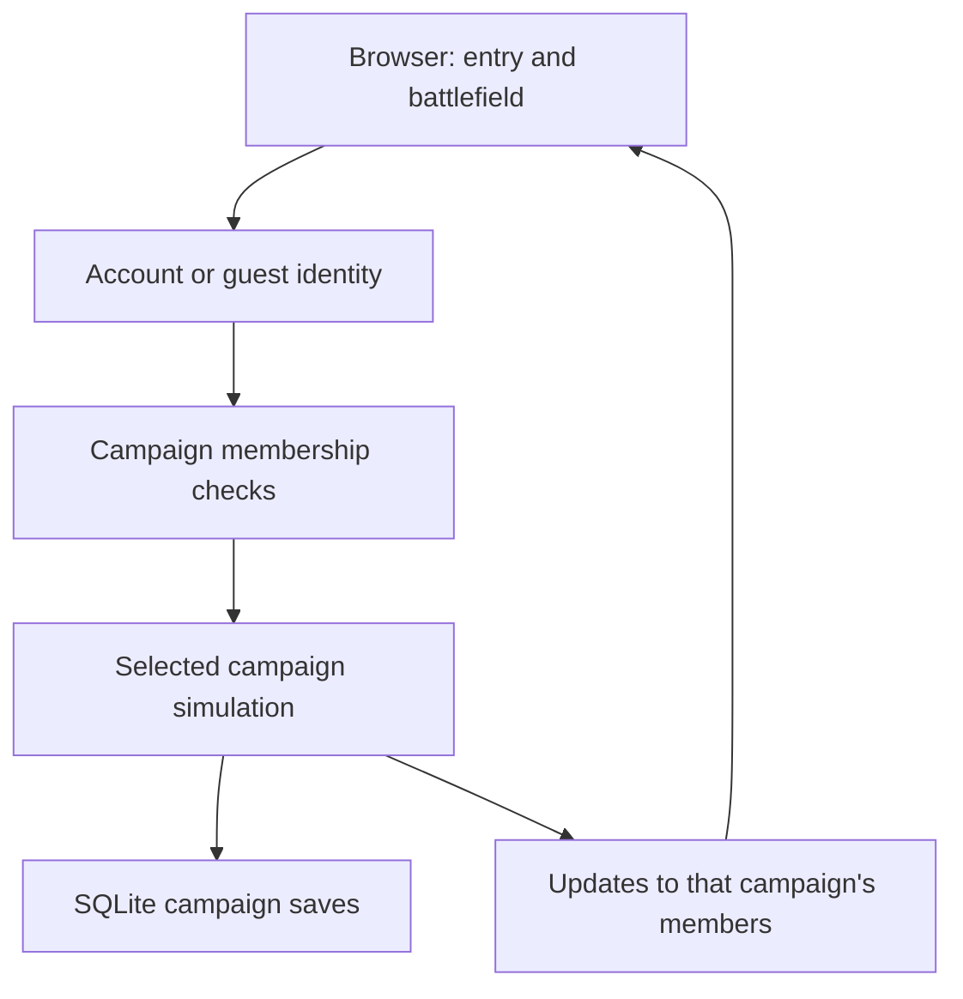

# Next stage: owned campaigns and saved return

9 October 2026. **Campaign foundation implemented locally; later stages remain
planned.** The implementation record below supersedes the earlier proposed
architecture where specified. Author answers remain intact. This follows
[GAME_DESIGN.md](../GAME_DESIGN.md) and [ENTRY_AND_CAMPAIGNS.md](ENTRY_AND_CAMPAIGNS.md).

## Where we are

**Current:** optional Email/Demo accounts, owned saved campaigns, single-use room
codes, remembered account membership, Caldera selection and orbital landing. The old shared world
is retained separately. Actual Brevo inbox delivery remains unverified; invitation
email, account-addressed invitations and a game inbox are not part of this stage.

**Agreed:** own a saved campaign or join a friend's; start with one planet
template; teammates' changes remain in that campaign; returning players resume
their saved state. No initial ground operator before core deployment. Permanent
conquest and global construction remain the game direction.

**Review status:** the four author answers below are preserved verbatim. They
request owner-present rooms, invitations by code/email, personal pause during
multiplayer, and shared use of unoccupied equipment. Follow-up answers confirm:
owner exit saves and closes the room, unregistered guests can join only, Email/Demo
accounts can host, and invited accounts retain membership. Departing guests'
contributions remain, with the host able to manage their buildings. Detailed
guest-session expiry and pause/disconnect rules are specified below. Original recommendations
are not accepted rules where the answers disagree with them.

## Implemented foundation: architecture and lifecycle

Open `/` or `/campaigns/`, or choose **Campaigns** in the legacy battlefield header.
Email/Demo accounts can create a named Caldera save, open it, and use **Room** to
issue a code or leave. Guests can join by code but cannot create a campaign.
The legacy battlefield remains at `/?legacy=1`. The subsequent planet-entry
stage adds Caldera's animated selector and makes the lobby the default entry;
see [ENTRY_AND_CAMPAIGNS.md](ENTRY_AND_CAMPAIGNS.md). Economy is reserved for
later design in [ECONOMY_DESIGN.md](ECONOMY_DESIGN.md), without new spending rules.

The architecture is one Node process with two layers:

- `accounts/` and `campaigns/service.js`: shared identity, campaign registry,
  membership, code redemption, admission and room lifecycle.
- A separate `createWorldApp` runtime and `campaigns/<uuid>/world.sqlite` per open
  campaign: terrain, robot/vehicle state, construction, collision, combat and SSE
  streams. Authentication stays in the original database and is injected into
  these runtimes; it is not copied into each world.

The original `world.sqlite` retains accounts and the legacy world, with additive
campaign registry tables. Before creating that registry, SQLite `VACUUM INTO`
makes a complete root-database backup under `backups/`, including committed WAL
data. Existing terrain, player IDs and ownership are not reassigned or regenerated.
New campaigns use the existing template rather than copying legacy construction.

Every campaign request and stream needs a live authorized visit. The server checks
membership and session, then resolves the campaign runtime. Delayed request bodies
are rechecked against the exact visit and runtime before mutation, so closing and
reopening a room cannot make an old command valid again. Account revocation closes
the owner's room or ends a member's visit. Rooms reopen closed after server restart.

**Agreed lifecycle, including the follow-up replies:**

- Explicit owner leave, logout or account takeover saves and closes the room;
  members return to the lobby. Account members can rejoin when the owner opens it.
- Owner connection loss freezes simulation immediately for up to 30 seconds.
  Reconnecting resumes the same room; expiry saves and closes it. Authentication
  expiry uses real time and never pauses. An owner in orbital survey counts as
  present, so connected members can play while the owner chooses their landing.
- Room/Help menus pause a solo room. Multiplayer keeps running even if all menus
  are open. A second admitted player resumes a paused solo room and triggers a
  warning. Opening a member's menu stops only that member's controls.
- An unregistered visitor keeps their personal visit across a refresh or transport
  interruption within 30 seconds. Deliberate leave, grace expiry, owner closure or
  restart ends that visit; another code starts a new orbital pilot. Their old
  buildings and core stay in the campaign. The host gains existing management
  actions, such as sentry mode/removal and rail removal, for abandoned ownership.
  This does not add new core/vehicle dismantling features.
- Departing guests release vehicle seats; registered players retain saved seats.
  Guest registration before the visit ends promotes membership while retaining
  that campaign's pilot and core. New credential activation still revokes live
  control and requires login. No cross-campaign equipment transfer is introduced.

**Invitations:** 96-bit random codes, hashed in storage, single-use and valid for
30 minutes while the room remains open. Only the connected owner issues or revokes
them. Redemption checks capacity and grants membership/consumes the code in one
transaction. Failed admission does not spend it; merely opening a page consumes
nothing. Codes may be forwarded before use; account-bound invitations remain later.

**Sleep and durability:** closed campaigns unload their runtimes. Campaign combat
checkpoints retain simulation time, enemies/health/paths, pending shells/jets/
barrages, active hazards/capacity and weapon cooldowns. Save checkpoints after
accepted commands, every 500 ms during active simulation, on pause/disconnect and
before closure. Each checkpoint commits player/vehicle state and combat together.
Abrupt process loss can roll back simulation since the last checkpoint; accepted
construction remains durable. No offline catch-up damage or time advancement.
Held charges/inputs and manual control are cancelled; cosmetic particles/crater
history are not restored. Legacy-world combat remains transient. This deliberately
extends persistence only for named campaigns.

**Initial bounds:** four distinct players including the owner per room, two loaded
campaigns process-wide, three saved campaigns per account and 1,000 saved campaigns
overall. At most eight unused invitations per room; mutation attempts are bounded.
These are conservative prototype admission limits, not a measured sustained-combat
capacity claim. The legacy test world is an additional retained runtime. Closed
campaigns consume storage but do not keep a combat loop running.

Local reset tooling resets only the legacy world, retains named campaigns and
their membership, signs accounts out and revokes invitation codes. Its backup is
of the root database, not an archive of every named campaign. No public reset or
campaign deletion endpoint was introduced. No Fly deployment or real email was
performed in this stage.

Validation: `pnpm check` passed typecheck and **185 tests in 34 files**. Integration
test workers are capped at four; the disk backup/restore test has a 15-second
deadline after its former five-second limit proved intermittent in full runs.
Its backup contents, integrity and retention assertions are unchanged. Tests exercise
campaign isolation, guest promotion/management, invite races and capacity, stale
commands after reopening, pause/reconnect, saved combat and legacy reset retention.
All **six selected desktop/phone browser checks** passed: accounts, orbital entry
and campaign create/invite/join/landing/close/return. Screenshots were inspected at
1920x1080 and 390x844; the phone header was adjusted to keep room controls legible.

The production Node **24.21.0** Docker image builds. An isolated `--network none
--memory 256m --cpus 1` container ran two campaigns/five HTTP clients (four in one
room), two core deployments and 12 seconds of simultaneous basic drills, then
closed and reopened a save. Peak sampled process RSS was **115.6 MiB**, including
both the server and test clients in one process. This is a short compatibility
check, not a sustained mixed-combat capacity claim, and excludes browser rendering.
The first smoke fixture put the core on the drill beacon and correctly failed the
route check; moving the test core clear of the beacon allowed both drills to run.
No real local world was reset and no production deployment was performed.

## Small stages with observable results

| Stage | Player-visible result | Evidence before moving on |
| --- | --- | --- |
| 1. Campaign foundation (implemented locally) | Create, join and resume from a plain campaign list. Separate campaigns have separate progress. | Two accounts in different campaigns cannot see or change each other's world; invited players share one; saves survive restart. |
| 2. Planet entry (implemented locally) | One Caldera card leads to creation; invitations and saves bypass selection, then enter orbital landing or saved return. | Desktop/phone create, invite, keyboard selection, reduced motion, saved return and legacy landing checks pass; see the entry-stage record. |
| 3. First conquest (implemented locally) | Destroy one alert station with HE; remove its hostile overlay and keep a conquered marker/ruin. | Shared damage/completion, surviving defenders, bounded calls and saved return; see CONQUEST_STAGE.md. |
| 4. Threat and recovery | One enemy can threaten one facility, with understandable damage and recovery. | Resolve armor and all-core-loss rules before enabling destruction; test failure as well as victory. |
| 5. Representative battle | Existing ground, naval and air systems serve a shared objective. | Tune costs/threats, measure sustained mixed combat, then choose capacity limits and any justified hosting change. |

These are dependency-ordered proposals, not authorization for a whole roadmap.
Art, audio and controls can improve within a stage once its rules are testable.
The existing enemy worksheet remains useful; no need to rewrite its filled answers.

## Fill only these four answers now

Short English or Chinese answers, examples and "use your recommendation" are fine.
The agent handles schema, state machines and technical checks.

1. **Owner offline:** may existing members enter and continue the campaign?
   Recommendation: yes; "host" means save owner, while Fly runs the simulation.
   Pause an empty campaign; it need not run because its owner has an account.

   My answer: Yes they can, they can join the game as long as the host is playing, they cannot join a game isn't running. And I think when host is offline, they cannot join, they can play on their own as host. Then I plan to use a way of both real email inviting, and the inviting code, like Steam. And maybe a thing within, if we can set a thing, about registered accounts, and check their status of online or not. And we can like select an account, player, and send the invitation email to them. And there are two cases, first the real email registered users, second the dummy email, it cannot be received by a mailbox, then if we need to add in game box? Like a pop out window to show the someone invites you. And the host pause the game will not influence the game process, if someone joins, if single, then everything is paused. Which means if 2 players play the game, each member pauses the game will not stop the enemy, the robot, facilities, vehicles will be destroyed with get attacked. And the host quit the game will disconnect the rest all players, for the data stores on the host's server. And I have a question, for we deploy the game on fly server, if it is only one central server? I mean for other games, they have server, but some computations are performed locally, but here, actually we played all on one server? If so I think some logic might change.

2. **Guests:** may a guest create a saved campaign, or only join one?
   Recommendation: allow creation and preserve ownership when they register.
   Explain that losing the browser identity before registering loses access;
   do not promise email recovery for an unregistered guest.

   My answer: Only join one, if you use guest this word, each player can create their own game, and can choose to join. And if they choose to join others, other players cannot join he or her campaign, for he or she does not open a room. Yes the later unregistered guest's save will not be preserved.

3. **Invitations:** how should a friend join?
   Recommendation: an owner-created invite link, with a confirmation showing
   which campaign they will join. No public room directory for this stage.
   The owner can invalidate an unused link. Link expiry/use limits are technical
   safeguards; invalidating a link does not silently remove existing members.
   Say if you prefer a short room code or approval for every joining player.

   My answer: I mentioned in point 1. Yes no public room. And if we need to set the limitation? 2-4 players or less? I think the invitation code, if we can design in this way? We generate the code, and each code can be used only once, then we can easily guarantine only the invitation code we send, maybe through phone, message or other way, can only be valid once, and will not get passed by others. If this authentication can be implemented? And yes the email link, it is more explicit, when user clicked this link, will be redirected to the page, with the sign in page. If they already signed in, then will maybe linking to the host, or join in the squad, or maybe interesting one, linking to the battleship fleet. And enter the map, not the planet selection, for it is fixed by the host, and then landing, play. If it is implementable? 

4. **Member powers:** what can a teammate change?
   Recommendation: members can deploy and use available shared equipment under
   existing ownership/seat rules; owner-only removal/loadout changes stay as they
   are. Only the campaign owner issues invitations. No campaign deletion, public
   reset or ownership transfer in this first stage. Say if members should instead
   be able to dismantle or reconfigure each other's equipment.

   My answer: Yes your are right, can share the facility, the vehicles, no, players cannot rob other's equipment, only can use the unattended weapons.

## Review of the filled answers (before implementation)

This discussion is retained as design history. The implemented foundation and
subsequent lifecycle replies are recorded above; historical "open" wording here
does not override that current contract. Invitations by account/email, presence
still remain later work. The subsequent planet selector and first alert-station
conquest are now local; other conquest objectives remain future work.

### Server and player responsibilities

**Verified current code:** `server.js` owns the authoritative simulation, damage,
placement, saved state and event streams. `public/app.js` draws the Canvas scene,
animates effects and sends controls through HTTP; updates arrive through SSE.
The deployment configuration specifies one Fly machine and a persistent volume.
This review did not inspect the live Fly deployment.

The owner's computer is a client, not the save server. Multiple isolated campaigns
can be implemented within the same Node process; each does not need another Fly
machine. They share its finite CPU, memory and network capacity. Closing an owner-
present room is therefore a game policy, not a storage necessity. Keeping friends
playing while the owner is offline is also technically possible.

### Clear requests, not yet implemented

- No public room directory. A player hosting their own campaign and one visiting
  another campaign are different roles. Simply owning a save does not open it.
- Support invitations by single-use code and addressed invitation. The author
  also wants account selection, online status and in-game invitation notices.
- An accepted invitation selects the host's campaign and planet. After any needed
  login and explicit acceptance, a new participant goes to orbital landing;
  an existing participant resumes saved life/seat/deployment. No redundant planet
  selection and no free replacement core on each invitation.
- A personal menu must not pause a multiplayer battle, even when every participant
  has a menu open. The author's intended solo pause freezes gameplay. Whether
  admitting another player automatically resumes a paused solo room needs a rule.
  Damage while menus are open follows each entity's implemented damage rules;
  this request does not itself implement destruction of all facilities/aircraft.
- Share available facilities/vehicles without ejecting another operator or taking
  their personal equipment. Retain owner-only removal/loadout changes. A saved
  occupied vehicle is not automatically "unattended" because its pilot disconnects;
  changing that existing seat rule would require a separate decision.

### Invitation feasibility and boundaries

Single-use codes are feasible with an atomic server transaction: authorize entry,
check room/capacity/expiry, record membership and consume the code together. Two
simultaneous redemptions cannot both succeed. Failed admission should not spend
the code. Opening an email link, including automated mail-link previews, must not
consume it; sign in and explicitly accept first. Use unpredictable codes, bounded
attempts, expiration and owner revocation.

A generic code can be forwarded before redemption; its first valid redeemer wins.
It cannot guarantee the redeemer is the intended friend. An account-addressed
invitation can require that exact signed-in account. Recommend account-bound
invitations when selecting a recipient, and clearly label generic codes as usable
by their first holder. An email address alone must not grant access to an account.

Recommend a shared **game invitation inbox** for both Email and Demo accounts,
with real email as an extra notification for verified Email recipients. This is
separate from the existing private Demo inbox for verification/password links.
Online recipients can see an in-game notice; offline recipients see the saved
invitation when they next sign in. SMTP failure should not lose that invitation.
These are proposed additions, not currently supported by the authentication inbox.

Recommend exact public player identifiers or an invited/recent-player list for
recipient selection. Avoid a public list of account emails and global presence.
Limit status visibility to an agreed relationship; distinguish online from having
an open, joinable room. Friends lists and presence can follow basic code joining.

### Follow-up decisions and remaining question

1. **Owner requirement after the architecture explanation:** still close the room
   when its owner leaves, or allow admitted members to continue?

   **Agreed follow-up:** "Yes: save and return everyone to the lobby." Owner
   presence remains a game rule even though Fly stores and simulates the world.

2. **Guest means no account:** may that person only join, or also host a temporary
   campaign? A visiting teammate with an Email/Demo account is not an unregistered
   guest. The answer's "only join" and "each player can create" need this distinction.

   **Agreed follow-up:** "Can join only; Email/Demo accounts can host." A
   registered visiting teammate retains their own campaign but does not keep it
   open while playing elsewhere.

3. **Rejoining:** after one successful invitation, does membership persist across
   room sessions, or must the owner issue a new invitation each time? Recommendation:
   persistent account membership, still subject to the owner's room-open rule.

   **Agreed follow-up:** "Yes: remember campaign membership (recommended)."
   Redeeming an invitation establishes lasting account membership; re-entry still
   requires the owner to have opened that campaign. This does not establish lasting
   account identity for unregistered guests.

4. **Guest save boundary:** the answer requests no retained unregistered guest save.

   **Agreed follow-up:** "Yes, retain contributions and let the host manage them
   (recommended)." Keep accepted buildings and conquest in the host's world after
   the guest leaves, with host management of those buildings. This does not give
   the host permission to take over an active player's occupied equipment.
   Precisely when personal guest access expires remains to be defined: refresh,
   connection loss and deliberate exit must not accidentally mean the same thing.
   Do not delete existing guest saves as part of this design review.

### Proposed implementation order and remaining engineering work

First implement campaign isolation, legacy migration and the selected owner/guest
rules. Then add code redemption and returning membership, followed by the planet
entry UI. Add addressed invitations/in-game notices, optional SMTP notifications
and scoped presence in a subsequent small stage. The fleet/squad wording can be
presentation; it need not introduce separate fleet simulation or membership now.

Keep solo play supported. Four players including the owner is a proposed room cap,
not a measured capacity claim; validate two first, then four in sustained battles.
Also cap the total active campaigns across the server. The current 16-stream guard
in the shared prototype counts connections, not distinct players or future rooms.

With owner presence required, distinguish explicit "Close room" from a short
network interruption. Recommend immediate save/closure for deliberate exit and a
brief reconnect grace period for interruption; the duration and whether simulation
freezes during grace remain open. Enforce pause on the server, freeze simulation
timers rather than authentication expiry, and stop held inputs. Specify the solo-
pause-to-multiplayer transition before implementation.

Closing a room also needs a combat save contract. Current enemies, projectiles and
hazards are transient on server restart. Do not imply that all of them survive a
room unload merely because construction is saved. Define bounded persistence or
another explicit, reviewed close/resume rule before unloading active battles;
accepted missiles must not silently disappear. These are engineering/design tasks,
not reasons to abandon the requested room model.

## Proposed architecture and first-stage scope

Keep the browser Canvas renderer, one Node service and SQLite. No engine rewrite,
microservices or separate server process per campaign is required for this stage.
Current code opens a single world and simulation in `server.js`; simply adding
a planet card would not isolate it.

Separate identity from each campaign's player presence, equipment and progress.
A person can belong to multiple campaigns without carrying a tank or core between
them. This is a proposed first-stage boundary, not a cross-campaign inventory
feature. Keep the existing world as an explicitly labelled legacy shared world;
do not give it to the first registrant or erase it during migration.

Resolve membership before every read, command and event stream. Scope caches,
collision, entity lookup, simulation and broadcasts as well as database queries.
A campaign ID or entity ID supplied by a client is not proof of permission.
Keep authentication separate from loading a live campaign. The implementation
brief should select the storage layout and migration procedure after these rules
are settled; passwords and ownership links must survive that migration.

Proposed presence flow: campaign list -> authorized entry -> saved orbital,
deploying, active, disabled or embarked state. Leaving/switching closes the old
stream, stops held actions and releases manual controls before entering another
campaign. Preserve each campaign's saved seat/life state under existing rules.
An occupied gun remains exclusive when two players try to take control.

Bound total active campaigns and work across the process, not just per room.
Decide admission limits from measurement; the intended 1-4 players per campaign
does not establish how many simultaneous campaigns this machine can serve.
Define orbital-viewer activity, idle suspension and restart semantics before
unloading simulations. Do not silently drop accepted missiles, reset an unfinished
fight, or claim transient combat is durable. Idle/unload behavior needs its own
explicit save contract and tests; no new offline damage should appear by accident.

## Acceptance and review

- New campaign: one template, authorized owner/member, initial orbital state,
  no pre-landing body and no duplicate deployment after retry/reconnect.
- Isolation: direct requests, stale streams and foreign entity IDs cannot expose
  or modify another campaign. Membership/identity changes revoke old access.
- Cooperation: two browsers see accepted building changes and combat in their
  campaign; simultaneous placement and control conflicts have one valid result.
- Return: restart, logout/login and campaign switching retain the correct saved
  construction, life, vehicle seat and position without duplicating ownership.
- Migration: back up and test on a copy; preserve legacy construction, guest
  access and accounts. Update reset tooling deliberately for the new schema.
- Feedback: identify the current campaign; explain invalid invites, full rooms,
  saving/reconnection and lack of permission. Check desktop and phone views.
- Budget: measure active and idle worlds, tick time, memory and snapshot traffic;
  establish limits without claiming an empty-world smoke check proves capacity.

The foundation's migration and sleep contract is now recorded above. For each
subsequent stage, implement one small result, verify it, let the author play,
record accepted changes and proceed. Keep README updates at stage checkpoints.
The author's review question is: "Can I start my own world, invite a friend,
and return to exactly the campaign and progress I expect?"
