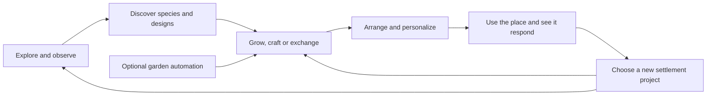

# Frontier colonization: a place to make your own

2 November 2026. Research and design proposal following the author's request
for a broader casual game, extensive decoration and comparable gameplay
references. This proposes a direction and a first playable expansion. It does
not implement features or record approval of every suggested system.

Author follow-up, 2 November: planet-specific content is welcomed; exploration
needs a larger world; machinery should move while performing a task and remain
still when idle. Colonies can support humanity's war effort through their own
logistics and lore, but must not connect to Frontier combat saves. These are
confirmed requirements. The regional layout and example contracts below are
proposed ways to fulfill them, not implemented features.

Implementation follow-up, 2 November: the author approved orbital placement,
animated material shuttles and a first-planet redesign. The
[Morrow expansion stage](COLONY_MORROW_EXPANSION_STAGE.md) now implements the
furnishing editor, four projects, two exploration regions, six discoveries and
work-driven machinery. The baseline review below describes the source before
that implementation; remaining roadmap items are still proposals.

## The experience

**Build a home on an alien world through the machines that connect you to it.**

The human operators aboard MYCORRHIZAL already have a reason to cultivate and
connect the planet. Give them personal reasons to enjoy being there: a favorite
shoreline, a garden they arranged, a curious mechanical companion, a workshop
with warm windows, and a cinema courtyard where the expedition gathers.

The player should be able to choose between making something, discovering
something and spending time in the place they have made. Farming and industry
provide materials and useful conveniences. The settlement gives those outputs
meaning beyond buying another production machine.

This retains the separate peaceful expedition and its established human-network
destination. The player's robot remains their presence on the surface; new crew
characters can participate through their own machines or ship communications.
The colony also supplies the wider human war effort. That role is represented
inside this expedition, with its own requests and shipment records; no combat
save participates.

## Baseline when this proposal was written

The source review found three crops, free seeds/watering, sprinklers, shared
storage, raw-crop exports, automated harvest outlets, conveyors, food processors,
bio-generators and provision exports. Shared daylight/weather, campfires and a
synchronized outdoor cinema are also implemented. Weather is currently visual;
rain does not irrigate crops. See the [garden stage](COLONIZATION_STAGE.md),
[industry stage](COLONY_INDUSTRY_STAGE.md) and
[atmosphere stage](COLONY_ANIMATION_AND_MEDIA.md).

The current milestones stop after first planting, harvest and shipment. There
is no broad furnishing catalogue, developed discovery journal, varied request
board or general move/store/undo editor. Construction remains within 14 tiles
of the hub, inside a 72-by-56-tile surveyed district. Current planetary differences
are principally geography and presentation, with shared crops and economy.

Fishing, ponds, cabins and network commissioning are already recorded in the
[settlement-life proposal](COLONY_INDUSTRY_PROPOSAL.md). The author also requested
a [furry mechanical spider companion](COLONY_MECHANICAL_SPIDER_PET.md) alongside
a richer exploration world. This proposal connects those ideas into a wider
experience rather than treating them as unrelated additions.

The current source and existing validation screenshots were inspected for this
proposal. No new gameplay or usability test was performed. All new counts and
pacing below are provisional design targets.

## Comparable games and the useful conventions

These are developer/publisher descriptions checked on 2 November 2026. The
adaptations in the last column are our design recommendations, not features
claimed by those sources or by the current Frontier build.

| Reference and verified mechanics | Useful convention | Original application here |
| --- | --- | --- |
| [Animal Crossing: New Horizons — Nintendo](https://www.nintendo.com/us/store/products/animal-crossing-new-horizons-switch/): furniture crafting/decoration, fishing, specimen collections and resident relationships. | Several parallel interests give players different reasons to return. | A botanical journal, individually arranged colony spaces, and a few operators with personal projects. |
| [Stardew Valley — official about page](https://www.stardewvalley.net/about/): farming, fishing, foraging, community restoration and house customization. | Small activities contribute to a larger place and long-term projects. | Gardening, surveys and short crafting recipes contribute to a conservatory, lakeside pavilion and orbital connection. |
| [Tiny Glade — developer store page](https://store.steampowered.com/app/2198150/Tiny_Glade/): free-form construction with adapting architectural details and freely revisable creations. | Making and revising an attractive scene can be enjoyable in itself. | Forgiving placement, connecting paths, matching borders, coherent colour variants and satisfying lights. Retain our current projection and grid. |
| [Astroneer — developer store page](https://store.steampowered.com/app/361420/ASTRONEER/): modular bases, crafting/automation, planetary exploration and cooperative play. | Home infrastructure supports expeditions; expeditions bring useful discoveries home. | A survey walk finds a species or material sample that unlocks a planter, object or workshop recipe. Its survival pressures are not required here. |
| [Terra Nil — developer store page](https://store.steampowered.com/app/1593030/Terra_Nil/): environmental reconstruction, habitats and wildlife, followed by removal of machinery. | Visible landscape change can make an objective emotionally rewarding. | Completing a native garden brings bloom, small creatures and new ambience. Our colony remains inhabited, and its existing living worlds retain their character. |
| [Dorfromantik — developer store page](https://store.steampowered.com/app/1455840/Dorfromantik/): landscape placement, local quests and unlockable tiles. | Clear, small goals can guide a player without prescribing the entire layout. | A few optional project cards offer a visible reward while leaving arrangement and aesthetic judgment to the player. |

These games demonstrate different pleasures, not a mandatory genre checklist.
Frontier can combine a few shared structures while creating its own characters,
objects, environments, interface, writing and progression. We do not need every
reference's calendar, survival rules, combat, social simulation or terrain tools.

## A connected set of activities

This describes connections, not a required sequence for every session. A player
can spend an evening arranging a pond, while a friend surveys the shore and
another improves the processing line. Each activity should have its own small
satisfaction and contribute to something visible.

### Create: decoration as a full activity

Start with a catalogue that is useful for composing places:

| Family | Example objects | What the player can make |
| --- | --- | --- |
| Ground and edges | Stepping stones, pale paving, timber decking, garden borders, short fences | Paths, courtyards and distinct garden rooms |
| Plants and water | Native flower clusters, specimen planters, reeds, trellises; later a bounded pond | Botanical displays and quiet waterside gardens |
| Light and shelter | Amber lamps, low path lights, hanging lights, awnings, a small pergola | Readable nighttime routes and inviting gathering spots |
| Furniture and personal objects | Robot parking seats, worktables, signs, flags, display plinths, painted panels | Spaces that look owned and used |
| Larger focal objects | Conservatory, white-framed timber cabin, observation deck, kinetic sculpture | A landmark around which to arrange the smaller pieces |

Include a generous starter kit early. Discoveries and projects unlock blueprints
and variants permanently; once unlocked, common pieces use modest amounts of
existing materials. Avoid a currency for every hobby. Large structures can be
longer projects, while small decorations should be easy to try.

The editor is part of the gameplay: preview footprint and cost, rotate where
meaningful, move without repayment, store without destruction, duplicate owned
pieces when affordable, and undo a recent supported decoration edit. Show a
clear reason when an item does not fit. Paths should connect and borders should
finish cleanly. Start with explicit variant choices before procedural building
generation.

Keep decorative freedom separate from industrial production statistics. A lamp
is valuable because the player likes its light. A themed grouping can receive
an optional acknowledgement or journal photograph without making every player
maximize a mandatory beauty score. Some objects should also be usable: sit/park,
switch a lamp, read a sign, pet the companion or gather at the existing cinema.

### Discover: bring something home

Add named places and readable points of interest to the surveyed district:
a quiet inlet, a flowering grove, a mineral shelf, an overlook. Observing or
sampling something records an illustrated entry and can unlock a display object,
planting recipe, paint colour or new activity. Collection progress should show
where to look next instead of relying on extremely rare random drops.

Begin with a small botanical journal. Later add shore fishing with generous bite
cues, a relaxed assist option, release and specimen-display choices. In-game
weather/time can vary encounters once those rules exist; no essential discovery
should require attendance at a particular real-world hour or a short-lived event.

The mechanical spider fits this naturally: follow, notice, investigate, signal,
return. It points out an actual nearby discovery or reacts to rain and machinery.
Petting and optional appearance variants make it a companion. It should remain
helpful without consuming scarce food or blocking progress when ignored. Build
the discoverable objects before the sensing behaviour.

### Give exploration enough space

The current district can support a few introductory discoveries. Sustained
exploration needs additional destinations, not just a larger construction radius.
Expanding where players can build and expanding where they can explore are
separate pieces of work.

Use a **persistent home district plus connected exploration regions** within
one colony save. Preserve the existing home geography, garden and machinery.
A region map shows named destinations, access routes, recorded discoveries and
unexplored leads. Start travel at a clear trail entrance or shuttle landing point
with a short transition. Seamless travel across one enormous map is not required
for the first version.

Pilot the home district plus two substantial exploration regions on one planet.
Give each a landmark, several discoveries, a distinct visual composition and a
reward worth bringing home. Choose dimensions from the content and measured
travel time rather than promising an arbitrary map multiplier. Broaden each
planet with its own destinations after that pilot works:

| Planet | Candidate destinations | Reasons to visit |
| --- | --- | --- |
| Morrow | Flowering woodland and a freshwater lake basin | Native blossoms, shoreline species, trellis designs and a fishing spot |
| Nacre | Fungal wetlands and a sheltered lagoon | Luminous specimens, reed varieties, pearl-coloured finishes and water observations |
| Aurelia | Wind-shaped uplands and mineral terraces | Mineral patterns, wind recordings, sculptural forms and an observatory site |

These are proposed contents, not newly generated terrain. Each planet should
support a complete independent expedition; essential progression must not depend
on importing an item from another save. Region discoveries persist on return.
Provide a convenient return route so the journey home does not become a chore.
Begin remote regions as exploration spaces; buildable outposts and inter-region
freight can follow once travel and discovery are satisfying.

Co-op players may occupy different regions while sharing one expedition, ledger,
project book and active clock. The home garden and industry continue operating
while players explore, even if nobody is viewing home. Existing pause,
host-disconnect and room-closure rules still stop the whole simulation. Rendering
or unloading a region must not decide whether its crops grow or cargo advances.

World expansion must be additive and backed up. Register the existing map as
the home region without regenerating it, then persist new region geography and
discoveries. Load/render terrain needed by current participants while retaining
the authoritative home production state. Region changes need a validated arrival
point, saved player region/position and protection against stale actions from
the previous region. This is a world/state change, not just increasing two map
dimension constants.

### Connect: people, shared places and a reason to continue

Start with a few named operators encountered through ship messages; later let
their proxy robots visit via the shuttle. Give each a small authored interest:
one cultivates unusual plants, one records planetary sound, another collects
objects that remind them of home. Their requests should reveal personality and
change the settlement in a visible way.

A request might supply a drawing for a listening pavilion, ask the player to
record two local sounds, and finish with the operator visiting the completed
place. Avoid launching a population simulation with hunger, housing penalties
and complex daily schedules. Short authored interactions are enough to test
whether players care about the crew.

Co-op continues to use one shared expedition. Players can contribute to projects
and enjoy a garden walk, fishing outing or movie night together. Add clear editing
permissions and attribution before expanding furniture ownership. Personal
colours and a display area can express identity without splitting the shared
economy into competing inventories.

### Supply the war effort through colony logistics

The author restores war support to the colony's purpose while explicitly keeping
combat saves separate. Peaceful everyday life and an industrial role in the
wider civilization can coexist: the player builds a comfortable settlement whose
exports serve distant fleets and campaigns.

Add optional requisitions at the orbital post alongside civilian exchanges.
Start with existing provisions; later contracts could request biomass fuel,
fabrication stock or replacement machine parts if those products are introduced.
A requisition shows its destination in the fiction, quantities and guaranteed
colony reward. Completing it loads a visible shipment and returns an acknowledgement,
materials, a blueprint or a commemorative object. Ordinary orders remain untimed;
any future rush-order variant must be an explicit choice.

For example, a distant logistics station requests provisions for its maintenance
crew. The colony prepares and dispatches the parcel; the player receives a thank-you
message and a cargo-yard decoration blueprint. This gives the existing production
line a narrative customer without requiring a simulated battle.

All requests, shipment results, dispatch history and rewards live in the colony
save. Any war bulletin is an authored colony narrative, not a report of an actual
Frontier combat campaign. There is no combat-save selection, import, handoff,
shared inventory, live combat-state read or write, or effect on anyone's military
campaign. An existing shared login remains an account feature, not a save link.
This supersedes the original optional post-combat handoff proposal. War support
does not require attacks on the colony or a recurring supply obligation.

## Machinery motion must follow work

Confirmed rule: **working machinery moves; idle machinery is mechanically still.**
Movement should explain what is being done. A paused or blocked task must not look
as though it is still producing or transporting something.

| Equipment | Work that drives motion | Idle or blocked appearance |
| --- | --- | --- |
| Sprinkler | Rotate the head and emit water while servicing a bed that needs irrigation | Head holds still and spray stops when there is no watering task |
| Conveyor | Animate tread/rollers and cargo while that segment advances an actual item | Empty or stopped segments hold still; queued cargo remains visibly in place |
| Harvest outlet | Extend/grip/retract for an accepted harvesting or replanting action | Arm rests while crops grow, storage is full or power is unavailable |
| Food processor | Turn mixers/rollers and advance a workpiece as recipe progress advances | Hold the mechanism when disabled, out of power or waiting between jobs |
| Bio-generator | Run its working mechanism and effects while fuel is being converted into energy | Stop when disabled, fuel is unavailable or energy storage is full |
| Cargo pad/shuttle | Load, lift, travel and unload as a shipment advances | Parked craft and cargo handling machinery remain still between shipments |

Some industrial motion already checks work state, and belt cargo is tied to real
inventory. However, the current belt chassis/treads are static, the harvest arm
has no task stroke, and the sprinkler rotates/sprays continuously. Existing
irrigation continuously refreshes covered beds. This unified rule is therefore
a planned refinement, not a claim that all the behaviours already exist.

Define an explicit sprinkler demand/service cycle on the server: a growing bed
needs water, an irrigation task restores its moisture, then the sprinkler rests
until needed again. Empty beds and fully grown crops do not create watering
tasks. Tune thresholds and service timing to preserve the current irrigation
coverage and reliable crop growth; do not implicitly add water costs or power
requirements. Overlapping sprinklers must not create duplicate work or misleading
spray. Saved task state and progress determine whether animation runs.

Use authoritative progress or accepted action events to drive mechanical phases.
Hold the phase while idle/blocked instead of advancing from a global clock or
snapping repeatedly to a new pose. A brief start/stop easing can soften the
motion without implying extra production. Cosmetic droplets and tiny particles
can remain local. Co-op clients must agree on which equipment is working; reload,
pause and reconnect restore the correct state.

Quiet status lights and a readable reason such as "Waiting for crop" or "Output
full" distinguish idle, blocked and disabled equipment. Reduced-animation mode
keeps these state cues while simplifying motion. Wind-blown foliage, flames,
water and weather retain their environmental movement; the task rule applies
to functional machine motion. Machine audio follows the same work/idle state.

## Gentle guidance and progression

Keep the three opening garden milestones, then introduce a project book with
at most three suggestions visible at once. Each card says what to do, where to
start, and what it unlocks. Players can pin one, postpone another and pursue
their own building ideas. No ordinary project expires.

| Stage | Example experience | Visible result |
| --- | --- | --- |
| First foothold | Grow a crop, send a parcel, place a starter path and lamp | A functioning garden with a personal touch |
| Make a place | Arrange a gathering corner and complete a small botanical survey | New furnishings and an illustrated record of the district |
| Develop a favourite activity | Choose gardening, fishing/discovery or workshop projects | A conservatory, waterside spot or useful production setup |
| Welcome the network | Prepare a shared space, exchange a varied shipment, finish the freight/communications installation | A visitor arrival and a commissioning celebration |
| Continue by choice | Complete collections, change layouts, explore another district, meet operators or fulfill optional civilian/military consignments | More expressive options, shipment stories and places to enjoy |

Network commissioning remains a clear completion moment. Its eventual
requirements should demonstrate a working settlement without demanding every
hobby or a large optimized factory. Keep manual and simple production routes
viable. Continued decoration and exploration remain available afterward.

For a newcomer, reveal tools when relevant, provide one recommended first layout
for machinery, show inputs/outputs clearly, and give recovery instructions when
a process stops. Preserve free seeds, paused dry crops, safe full storage and
the existing active-time save lifecycle. More depth should come from choices,
discoveries and layouts rather than longer timers or more compulsory chores.

## A possible short session

The player returns to their garden and collects a small harvest. They spend some
materials on lamps for the cinema path, then choose a project to record two
shoreline plants. On the walk they discover an iridescent reed, which adds a
journal illustration and unlocks a reed planter. Back home, they move a bench,
place the planter beside a cabin porch and watch the lamps come on at sunset.
A friend arrives and they spend a few minutes at the cinema.

That session has produced a discovery, a useful reward and a place that looks
more personal. A production-focused player could instead spend the same time
improving a conveyor route and funding a larger conservatory. Both contribute
to the same expedition.

## Our art should shape the activities

Retain the current civilian construction language: white metal, graphite joints,
glass, restrained gold/violet accents and cyan sensors, inside illustrated alien
landscapes. Wood, fabric and personal paint can soften furniture while its frames
and fittings still belong to Frontier. Keep the current tracked worker and
MYCORRHIZAL silhouettes recognizable. See the
[visual direction](COLONIZATION_VISUAL_DIRECTION.md) and
[movement updates](COLONY_MOVEMENT_AND_PERFORMANCE.md).

Use planetary identity to create different desirable objects and experiences:

| World | Established setting | Proposed decorative and discovery direction |
| --- | --- | --- |
| Morrow | Flowering woodland, meadows and freshwater ponds | Petal lamps, orchard trellises, timber porches, small native garden visitors |
| Nacre | Turquoise lagoons, pale shores and lavender fungal canopies | Pearl-toned lamps, reed screens, fungal planters, shore specimen displays |
| Aurelia | Golden uplands, mineral terraces and fan-like trees | Mineral mosaics, amber glazing, wind sculptures, shaded observation decks |

A discovered plant can supply a journal illustration, a world object and a
decorative motif. A cinema can become a stage for the author's own short scenes.
A cabin can express what an operator remembers about home. This makes original
art a reason to explore and build, as well as something the player looks at.

## Recommended build order

### First playable expansion: make the settlement your own

Implement the placement foundation and a compact but complete set of roughly
18-24 distinct furnishings: paths, borders, lights, seating/parking, planters,
signs and a small shelter. Colour variants do not count as separate objects.
Include move/store/rotate support and bounded decoration undo. Keep the initial
catalogue cheap enough to experiment with before extensive exporting.

Add four untimed introductory projects, for example a lit route, a gathering
corner, a planted display and a personalized landing welcome. These should teach
tools and offer variants, without judging the player's layout. Use a compact
project book and contextual catalogue that work with the existing phone dock.

Integrate the existing fires and cinema into coherent layouts. Start with the
current construction area; playtest its capacity with the new objects. If it
feels cramped, add a bounded survey-extension mechanism with safe placement and
performance checks. This expands building space; the connected regions in the
next stage supply exploration space. Do not regenerate old worlds.

Include the machinery work/idle animation pass in this stage. Establish real
sprinkler work state and make belt treads, harvest arms and other moving parts
reflect actual tasks. Verify empty, working, blocked, disabled, paused and
resumed states, including shared play and reduced animation.

Acceptance: a new player can arrange a recognizable personal corner, explain
their next project and rearrange it without losing materials. A saved layout
returns correctly, peers see the same edits, routes remain usable, and a densely
decorated phone scene stays readable and responsive. Compare two players' layouts
to see whether the catalogue supports meaningfully different compositions.

### Second expansion: somewhere to go

Build the connected-region foundation and pilot the existing home plus two
distinct exploration regions on one planet. Add a small field journal, named
discoveries and planet-specific plants/rewards. Follow with shore fishing, a
saved pond object, the cabin exterior and the spider's first real discovery
interactions. Extend the other planets with their own content after the pilot
works. Walk-in cabin interiors remain a separate stage.

Acceptance: exploration yields something players want to bring home; the
companion's signals correspond to real reachable things; discovering an item
once unlocks it reliably after reconnect/restart; fishing is understandable and
comfortable with touch controls. Region travel preserves the home garden and
shared progress, supports participants in different places, and keeps home
production running under the existing active-time rules.

### Third expansion: a connected colony

Add a few operators, optional commissions, a conservatory or observatory project,
the freight/communications installation and the commissioning celebration. Add
civilian and military supply requests with local shipment history and authored
acknowledgements. Detailed NPC schedules, large-scale terrain sculpting and
complex factory networks remain separate decisions.

Acceptance: players understand what they are building toward, can make progress
through more than one interest, and still want to revisit their settlement after
the formal completion moment. Establish pacing through playtests; no campaign
length is claimed here. Supply requests must function entirely within the colony
save, with no access to combat state and no cross-save resource transfers.

## Implementation considerations for the next stage

- Put decoration definitions in a catalogue with stable IDs, category, footprint,
  layer, variants, cost and allowed interactions. Keep authoritative saved
  placements separate from cosmetic animation. Reuse the existing projection.
- Apply move/store/undo as durable server commands with revisions and receipts.
  An undo must not reverse another player's newer change. Begin with decoration
  edits; production transactions require their existing cargo rules.
- Distinguish walkable paths from solid furniture. Validate placement and edits
  against workers, essential access, water, facilities and other saved objects.
  Use the industry's current route checks as a starting point, not the older
  garden's more limited collision assumptions.
- Add data to existing saves with versioned initialization and recoverable
  migrations. Keep colony/combat economies and lifecycle separate. Preserve
  established terrain and gardens.
- Add stable region IDs, per-player region locations, region-aware commands and
  terrain snapshots. Replace the single-world rendering assumptions deliberately;
  ordinary current snapshots omit terrain. Keep home simulation independent of
  which regions clients render, and restore matching terrain caches on travel.
- Treat work state and mechanical progress as shared simulation data. Animation
  must neither create cargo nor advance work while the expedition is paused.
- Batch or cache static decoration drawings, bound light/ambient effects, and
  measure representative populated desktop/phone scenes. Test co-op conflicts,
  restart/reload, inventory conservation and route safety for actual new rules.

The first implementation decision recommended by this research is the decoration
editor plus a small project book. Together they give the existing garden,
industry, weather and cinema a new purpose, while creating the foundation for
the previously requested leisure and exploration features.
