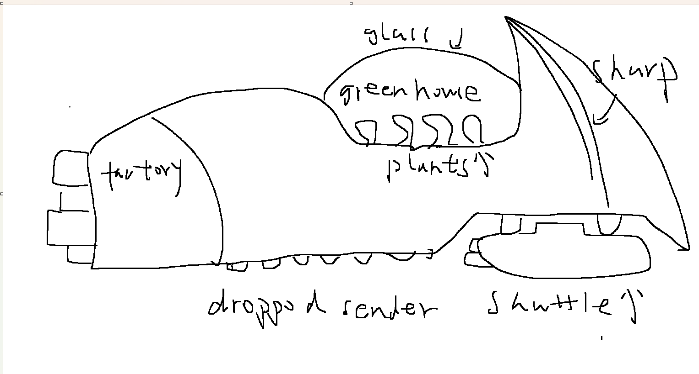

# Keep the target outside the conversation

Generative agents turn a few words into detailed work. Familiar solutions can
help when I lack a clear target, but can pull a defined target off course. My
position is that a designer should preserve an unchanged reference against which
to judge each interpretation: a sketch for form, a rule for behaviour, or their
own words for a sound. This makes disagreement visible without freezing the design.

## The drift enters early

Hintze et al. (2026) ran 700 image-caption trajectories of 100 iterations and
found 12 dominant motifs across their pooled results. They varied temperatures
and model combinations, but did not isolate training-data bias as the cause.
Their autonomous loops demonstrate convergence in that setting; they do not
establish what happens when a person keeps directing the work.

My spacecraft provides a smaller, directed case. I drew a scythe-shaped bow.
The prompt Codex wrote for the image tool asked for a "subtle swept
upper bow ridge" and to "avoid an enormous blade fin", so my drawing was softened
before any image existed. The first render was a smooth teardrop. Reviewing outputs
alone would miss where that change entered: the agent's translation of my reference.

*First sketch and first render; see [all versions and prompts](docs/evidence/mycorrhizal-carrier/README.md).*

## Does the pull reach the person?

Wadinambiarachchi et al. (2024) studied sixty students designing chatbot avatars
from a brief and supplied example. Midjourney users repeated more example features
than the other groups; originality fell only slightly. They were generating
alternatives to an assigned example, while I was refining my own drawing. That
difference limits the comparison, but does not establish that my target protected
me from fixation.

Confidence is weak evidence. METR's developers believed AI saved time while it
made their tasks take 19% longer (Becker et al., 2025). Its later study suggested
improvement, but participant and task selection made the estimate unreliable
(Becker et al., 2026). I take the measurement lesson, not a timeless verdict on AI.

## The case against me

The same spacecraft record challenges a rigid target. The final sheet's prompt
asked for "ONE broad fat cargo shuttle". Two berths appeared, and
Codex called them "erroneous" and asked for a fix. I saw two bays, left and right,
judged that better and adopted it. A generated image changed my design, by accident.

Schön's materials are "continually talking back" (1983, as quoted in Keer, 2018).
That account explains why preserving a reference need not mean enforcing it
forever. It lets me distinguish a deliberate revision from a change I failed to
notice. Fidelity and discovery can both matter, at different moments.

## The same split in sound

Sound makes the distinction clearer. I wanted individual machine-gun shots and
steady vehicle engines; generated bursts and revving missed those targets. My
rewritten [prompts](soundeffect/GENERATION.md) specify "zero revving, zero
acceleration" and "zero doppler". In the carrier prompt, the agent's exclusions
softened my target; these exclusions defended it. For the colony's mechanical
spider purr, I had no comparable reference and kept the proposed prompts almost
unchanged. Familiar conventions supplied something I could judge. The useful
question was which details I already cared about, rather than whether the whole
task was creative or technical.

## With no target, convention is a loan

The colony's economy exposed the cost of borrowing a design. I named machines;
Codex connected them into a production chain. Playing it, I called the power
startup "a dead loop". Manual loading could start it, but the interaction did not
make that route clear. A working chain still needed a comprehensible route into it.

Naur (1985) locates a program's theory in its programmers, with documentation
secondary. Goedecke (2026) argues that agents can build theories while debugging;
retaining them between runs is the difficulty. He also disputes Naur's strong
position on reconstructing understanding from code. This separates two problems:
how understanding is built, and how it survives a change of agent or programmer.
My concern is continuity: someone must retain enough understanding to judge the
next change. Documents support that responsibility; they do not discharge it.

## Where targets live

Böckeler (2026) connects guides that steer work with sensors that check its
results. My sketches and tests served those different roles. Her warning about
unstated requirements identifies a limit of evaluation: passing a check cannot
settle an intention the check never captured. It does not establish whether
better models will drift less.

This is one designer's project, not a controlled test of these theories. Its
practical lesson is to preserve references, compare interpretations, and record
why a target changes. That leaves room for surprise while keeping the designer
responsible for deciding what the surprise means.

## References

Becker, J., Rush, N., Barnes, B., & Rein, D. (2025, July 10). [*Measuring the impact of early-2025 AI on experienced open-source developer productivity*](https://metr.org/blog/2025-07-10-early-2025-ai-experienced-os-dev-study/). METR.

Becker, J., Rush, N., Cunningham, T., Rein, D., & Mahamud, K. (2026, February 24). [*We are changing our developer productivity experiment design*](https://metr.org/blog/2026-02-24-uplift-update/). METR.

Böckeler, B. (2026, April 2). [*Harness engineering for coding agent users*](https://martinfowler.com/articles/harness-engineering.html). martinfowler.com.

Goedecke, S. (2026, April 3). [*Programming (with AI agents) as theory building*](https://www.seangoedecke.com/programming-with-ai-agents-as-theory-building/).

Hintze, A., Proschinger Åström, F., & Schossau, J. (2026). Autonomous language-image generation loops converge to generic visual motifs. *Patterns, 7*(1), 101451. https://doi.org/10.1016/j.patter.2025.101451

Keer, L. (2018, September 3). [*Book review: The reflective practitioner*](https://drossbucket.com/2018/09/03/book-review-the-reflective-practitioner/). drossbucket.

Naur, P. (1985). [Programming as theory building](https://doi.org/10.1016/0165-6074(85)90032-8). *Microprocessing and Microprogramming, 15*(5), 253–261.

Schön, D. A. (1983). *The reflective practitioner: How professionals think in action*. Basic Books.

Wadinambiarachchi, S., Kelly, R. M., Pareek, S., Zhou, Q., & Velloso, E. (2024). The effects of generative AI on design fixation and divergent thinking. *CHI '24*. https://doi.org/10.1145/3613904.3642919
